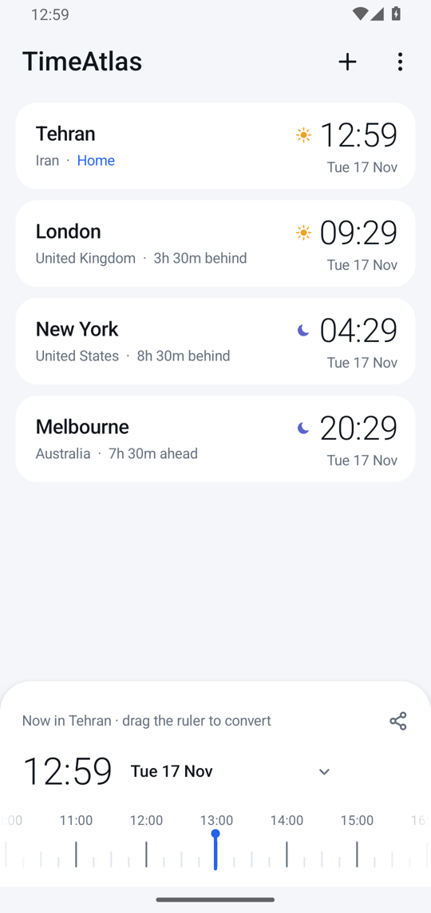
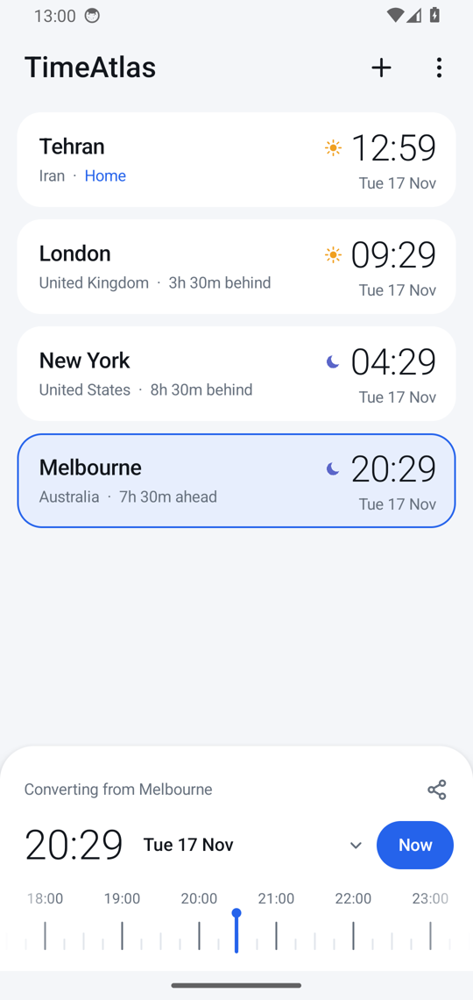
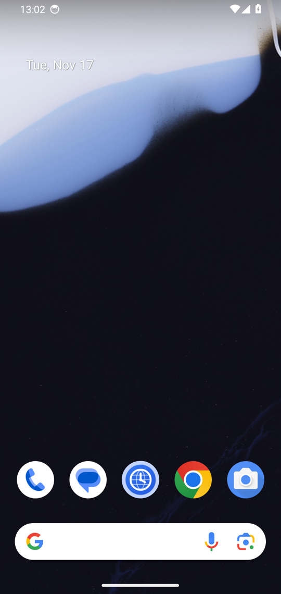
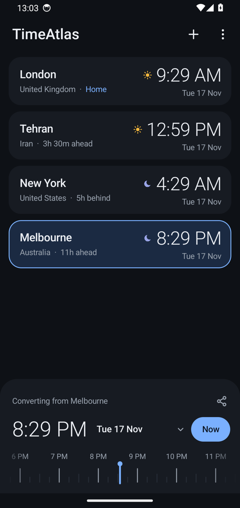

# TimeAtlas

A light, offline world clock for Android that answers the question most clock apps don't:
**"When it's 5:00 PM in Melbourne, what time is it in Tehran and New York?"**

- **Your cities, live** — each city shows its time, date, a day/night icon and how far ahead or behind your home city it is.
- **Convert any time** — tap a city and pick a time there, drag the time ruler, or choose a date. All cities convert instantly; tap **Now** to go back.
- **Correct on every date** — daylight-saving changes are taken from the phone's time-zone database for the exact date. If a chosen time does not exist (clocks jump forward) or happens twice (clocks go back), the app says so.
- **Fast search, no internet needed** — 400+ cities plus every other time zone of the phone. Search by city, country (`usa`, `uk`), state (`california`) or abbreviation (`pst`, `cet`, `irst`).
- **Widget** — up to 4 cities; rows when tall, columns when short and wide; Auto / Light / Dark / Clear styles. The times tick by themselves (no battery use).
- **Share** the converted times as text, **12/24-hour** and **light/dark** theme, drag to reorder, long-press a city to make it home.
- **Updates itself** from this repository's Releases (asks first; Android shows its own install confirmation).

| Live | 5 PM in Melbourne, everywhere | Widget | Dark, 12-hour |
| --- | --- | --- | --- |
|  |  |  |  |

## Install

Download `TimeAtlas.apk` from the [latest release](https://github.com/samaliyan/TimeAtlas/releases/latest) and open it.
Android 8.0 or newer.

## Build

Requires JDK 17 and the Android SDK (API 34). Open the project in Android Studio, or run:

```
gradle assembleRelease
```

There are no third-party libraries. Local builds are signed with the debug key; see `signing/README.md`.

## Tests

| What | How |
| --- | --- |
| Core logic (time math, DST, search, storage, share text) — 500 checks | `bash tests/run_core.sh` (runs on every build) |
| Full app on Android 8.0 and Android 14 emulators: every screen, widget on the home screen, in-app update from GitHub; screenshots go to the `ui-results-26` / `ui-results-34` branches | *Actions → UI test (emulator) → Run workflow* |

## Releases

Every push to `main` builds, lints, tests and signs the APK, then publishes it as the GitHub release for the
`versionName` in `app/build.gradle`, with notes from `CHANGELOG.md`. The repository secret `SIGNING_PASSWORD`
is required.
